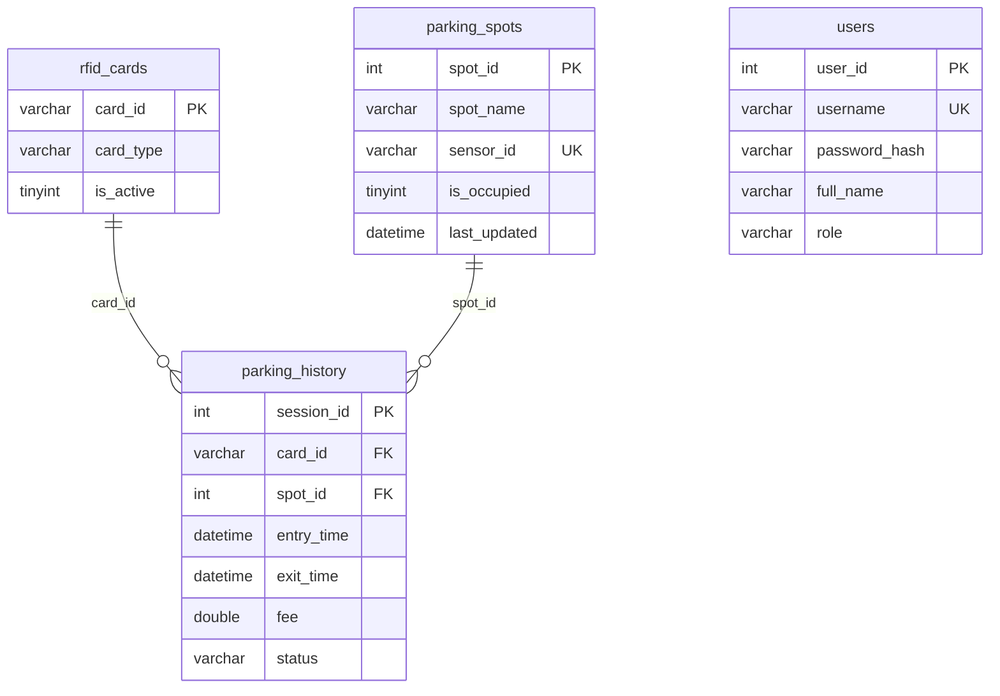

# Hệ thống giám sát nhà để xe

Dự án IoT quản lý nhà để xe nhỏ gồm **firmware ESP32** (cảm biến ô đỗ, thẻ RFID, barie, cảnh báo cháy) và **web quản lý Spring Boot**. Hai phần giao tiếp với nhau qua **MQTT**.

## Tính năng

### Thiết bị (ESP32)
- **Quẹt thẻ RFID (MFRC522):** gửi UID lên server, server quyết định cho xe vào hay ra.
- **Điều khiển 2 barie bằng servo:** cổng vào và cổng ra, tự đóng sau 4 giây.
- **Giám sát 3 ô đỗ:** cảm biến hồng ngoại có lọc nhiễu (lấy mẫu 30 lần, ngưỡng 24), gửi trạng thái từng ô lên server.
- **Cảnh báo cháy (DHT11):** khi nhiệt độ vượt ngưỡng, mở cả hai cổng để thoát hiểm, hiện cảnh báo trên LCD và gửi `FIRE` lên server. Khi nhiệt độ xuống lại dưới ngưỡng thì đóng cổng và trở về hoạt động bình thường.
- **Màn hình LCD 16x2:** hiển thị trạng thái ô đỗ, nhiệt độ, độ ẩm; hiện `full` khi hết chỗ.

### Web quản lý
- **Xử lý thẻ RFID:** tự xác định xe **vào** hay **ra** dựa vào database, tính tiền khi xe ra, rồi ra lệnh mở barie tương ứng.
- **Người dùng thường (bảo vệ) có thể:**
  - Xem trạng thái các ô đỗ (trống hoặc có xe), cập nhật theo thời gian thực từ cảm biến.
  - Xem lịch sử xe ra/vào (thẻ, ô đỗ, giờ vào, giờ ra, phí, trạng thái).
  - Gửi lệnh mở cổng thủ công từ server (cổng vào hoặc cổng ra).
- **Quản trị viên (ADMIN):** tài khoản có quyền cao nhất của hệ thống.

## Kiến trúc

```
 [Cảm biến ô đỗ] [RFID] [DHT11]               [Web Spring Boot]
          \         |      /                     |         \
           +---- ESP32 (FreeRTOS) ---MQTT---  Broker ---  MySQL
                 |         |                 (emqx)
              [LCD]   [Servo x2]
```

## Cấu trúc thư mục

```
BTL_HTCB/
├── Embedded_Firmware/        Firmware ESP32 (ESP-IDF)
│   ├── components/           Driver: lcd, servo, mfrc522, dht, wifi, mqtt, spi
│   └── main/sensor_system.c  Chương trình chính (các task FreeRTOS)
├── Web_Server/               Web quản lý (Spring Boot + Maven)
│   ├── database/             4 bảng (parking_history,parking_spot, rfid_cards, users)
│   └── src/main/java/com/baidoxe/parking_iot/
│       ├── controller/       REST controller (RFID, ô đỗ, lịch sử, mở cổng...)
│       ├── entity/           Các entity JPA
│       ├── repository/       Spring Data JPA
│       └── mqtt/             MqttSubscriber (nhận và gửi MQTT)
└── README.md
```

## Công nghệ

| Phần | Công nghệ |
|---|---|
| Firmware | ESP32, ESP-IDF v5.5.x, FreeRTOS, C |
| Web | Java, Spring Boot, Spring Data JPA, Maven |
| Giao tiếp | MQTT (Eclipse Paho), broker `broker.emqx.io` |
| Cơ sở dữ liệu | MySQL (InnoDB, utf8mb4) |

## Phần cứng

| Thiết bị | Chân ESP32 |
|---|---|
| LCD 16x2 I2C (địa chỉ 0x27) | SDA: GPIO21, SCL: GPIO22 |
| RFID MFRC522 (SPI) | SCK: GPIO18, MOSI: GPIO23, MISO: GPIO19, các chân điều khiển: GPIO17 (RST), GPIO5(CS) |
| Servo cổng vào | GPIO2 |
| Servo cổng ra | GPIO4 |
| Cảm biến ô đỗ 1, 2, 3 | GPIO14, GPIO26, GPIO27 |
| DHT11 | GPIO_25) |

Lưu ý: GPIO2 và GPIO5 là chân strapping của ESP32. Nếu board không boot được khi đã nối thiết bị thì rút tạm các chân này ra.

## Cơ sở dữ liệu

Database `baidoxe` gồm 4 bảng, file SQL nằm trong `Web_Server/database/`.



| Bảng | Vai trò |
|---|---|
| `users` | Tài khoản đăng nhập web, vai trò `ADMIN` hoặc `STAFF` (bảo vệ) |
| `parking_spots` | Ô đỗ, liên kết cảm biến qua `sensor_id` (1 đến 3) |
| `rfid_cards` | Thẻ RFID, `card_id` là UID thẻ, loại `GUEST` hoặc `VIP`, `is_active` cho biết thẻ còn hiệu lực, tạo thẻ mới bởi ADMIN |
| `parking_history` | Lượt gửi xe: giờ vào, giờ ra, phí, trạng thái (`PARKING` khi xe còn trong bãi) |

Thêm thẻ mới: chèn UID thẻ (đúng như thiết bị gửi lên, 10 ký tự hex viết hoa) vào bảng `rfid_cards`.

## Giao thức MQTT

Broker: `broker.emqx.io:1883` (broker công cộng, chỉ phù hợp để demo).

| Topic | Hướng | Payload | Ý nghĩa |
|---|---|---|---|
| `/ptit/parking/check` | ESP32 → Web | UID thẻ | Có thẻ được quẹt |
| `/ptit/servo/control` | Web → ESP32 | `1` hoặc `2` | Mở cổng vào / cổng ra, tự đóng sau 4 giây |
| `/ptit/servo/emergency` | Web → ESP32 | `O1`, `C1`, `O2`, `C2` | Mở/đóng cổng vào (1) hoặc ra (2), không tự đóng |
| `/state/park/<n>` | ESP32 → Web | `0` hoặc `1` | Trạng thái ô đỗ n (1 đến 3), web hiểu `0` là có xe |
| `/ptit/parking/environment` | ESP32 → Web | `27.5C, 60.0%` | Nhiệt độ và độ ẩm, 2 giây một lần |
| `/ptit/parking/alarm` | ESP32 → Web | `FIRE` | Phát hiện cháy |

## Hướng dẫn cài đặt và chạy

### 1. Clone dự án

```bat
git clone https://github.com/ThanhChungPtit/Parking_garage_surveillance_system.git
cd Parking_garage_surveillance_system
```

### 2. Cài đặt database

```bat
mysql -u root -p -e "CREATE DATABASE IF NOT EXISTS baidoxe CHARACTER SET utf8mb4"
mysql -u root -p baidoxe < Web_Server\database\baidoxe_users.sql
mysql -u root -p baidoxe < Web_Server\database\baidoxe_parking_spots.sql
mysql -u root -p baidoxe < Web_Server\database\baidoxe_rfid_cards.sql
mysql -u root -p baidoxe < Web_Server\database\baidoxe_parking_history.sql
```

Bảng `parking_history` import sau cùng vì có khóa ngoại tới `rfid_cards` và `parking_spots`.

### 3. Chạy web

Sửa `username` và `password` của database trong `Web_Server/src/main/resources/application.properties`, rồi:

```bat
cd Web_Server
mvnw.cmd spring-boot:run
```

Mở trình duyệt tại `http://localhost:8080`. Tài khoản mẫu trong file `baidoxe_users.sql`: `admin` (quản trị) và `baove1` (bảo vệ).

### 4. Nạp firmware (ESP-IDF v5.5.x)

```bat
cd Embedded_Firmware
idf.py set-target esp32
idf.py build
idf.py -p COMx flash monitor
```

Trước khi build, sửa tên và mật khẩu Wi-Fi trong `main/sensor_system.c` (hàm `wifi_init_sta`).

Các thông số cấu hình ở đầu file `sensor_system.c`:

| Macro | Mặc định | Ý nghĩa |
|---|---|---|
| `DHT_TEMP_LIMIT` | 40°C (mức ví dụ cho thầy cô hiểu) | Ngưỡng nhiệt độ báo cháy (°C) |
| `GATE_OPEN_TIME_MS` | 4000 | Thời gian barie mở trước khi tự đóng |
| `PARK_SAMPLE_COUNT` / `PARK_THRESHOLD` | 30 / 24 | Lọc nhiễu cảm biến ô đỗ |

## Luồng hoạt động

**Xe vào/ra bằng thẻ**
1. Xe quẹt thẻ, ESP32 gửi UID lên `/ptit/parking/check`.
2. Web tra bảng `rfid_cards` và `parking_history`: nếu thẻ chưa có lượt gửi đang mở thì là xe vào, ngược lại là xe ra và tính phí.
3. Nếu hợp lệ, web gửi `1` (vào) hoặc `2` (ra) lên `/ptit/servo/control`.
4. ESP32 mở barie, chờ 4 giây rồi tự đóng.

**Mở cổng thủ công:** bảo vệ đăng nhập web, chọn mở cổng vào hoặc cổng ra, web gửi lệnh MQTT tương ứng tới ESP32.

**Cảnh báo cháy:** nhiệt độ từ 40°C trở lên thì ESP32 mở cả hai cổng, hiện cảnh báo trên LCD và gửi `FIRE`. Khi nhiệt độ giảm xuống dưới ngưỡng, cổng đóng lại và hệ thống hoạt động bình thường.


Môn học: Hệ thống cảm biến / IoT, PTIT.
